<div align="center">


**AI 비전 기반 제조 품질 검사 · 분류 및 공정 점검 알림 시스템**
<br><sub>모블 제조 데이터 관리 및 전송 프로그램 과정 · 2차 팀 프로젝트</sub>


<br>

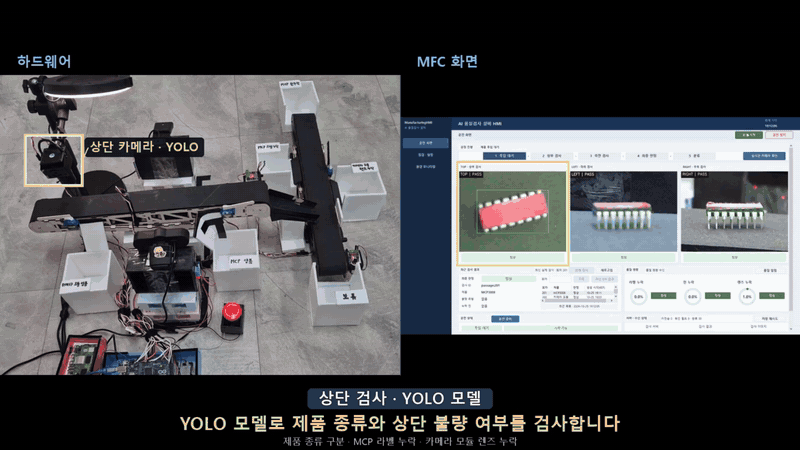
<br><sub>시연 영상 — 상단 YOLO · 측면 OpenCV 검사와 MFC 화면</sub>

</div>

<br>

## 📌 한눈에 보기

| | |
|---|---|
| **무엇을** | 카메라 모듈 · MCP3008 두 제품을 컨베이어에 섞어 흘리면, **비전으로 불량을 판정하고 불량 유형별로 자동 분류**하는 소형 제조 라인 |
| **검사** | 상단 YOLO(제품 종류 · 렌즈/라벨 누락) + 측면 OpenCV(핀 누락 · 위치) |
| **제어** | Arduino Mega 한 대가 메인 컨베이어 · 정상 배출 서보 · **불량분류 컨베이어** · 분류 가이드 서보 · 긴급정지 · 온습도를 통합 제어 |
| **운영** | MFC HMI(운전 · 수동 점검 · 환경 모니터링) ↔ ASP.NET API(Raspberry Pi) ↔ MySQL ↔ Flask 조회 웹 |
| **내 역할** | **불량분류(보조) 컨베이어 · 분류 가이드 서보 제어**, **긴급정지 NC 입력**, **DHT11 온습도 경보 + MFC 환경 탭**, 아두이노 회로 · 시리얼 통신 · 하드웨어 제작 |

<br>

<div align="center">
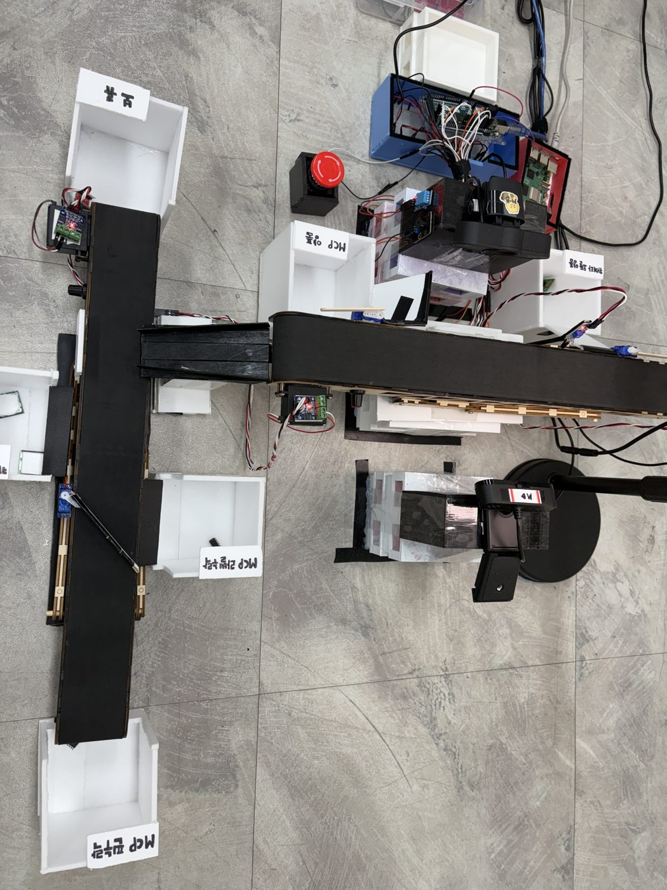 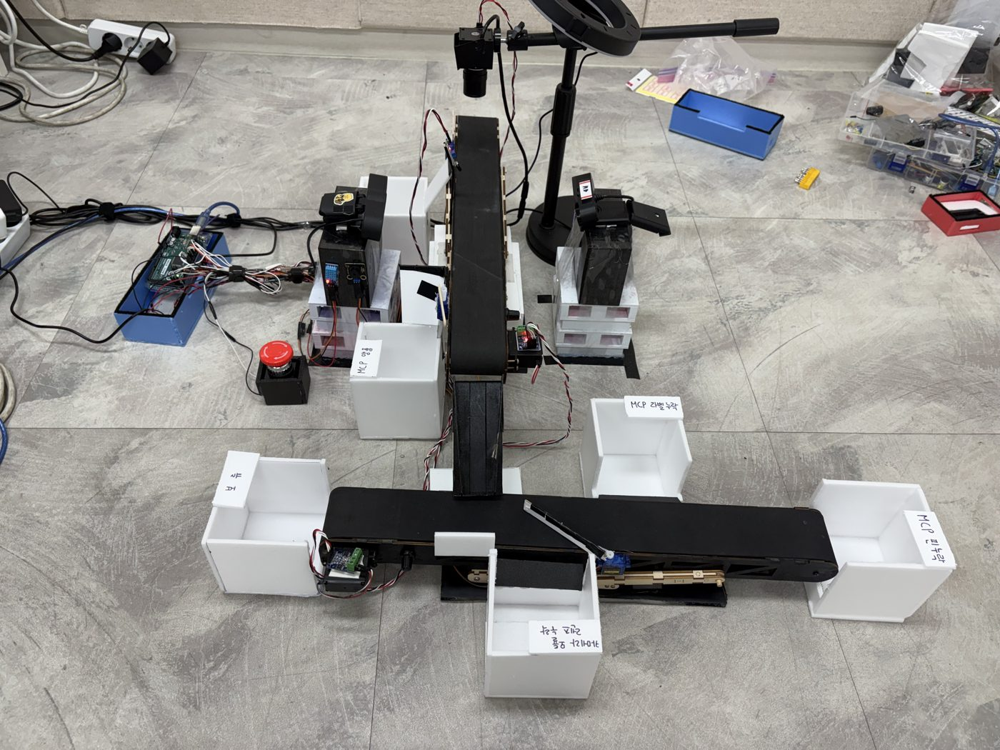
</div>

<br>

## 🧩 시스템 구성

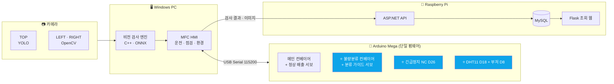

<br>

## 👥 팀 구성

| 이름 | 담당 |
|---|---|
| 이성민 (팀장) | 메인 컨베이어 · 서보 제어 및 테스트, 시스템 통합, GitHub 관리 |
| **조민경** | **아두이노 회로 · 시리얼 통신 · MFC · 하드웨어 제작 — 불량분류 컨베이어 · 긴급정지 · 환경 모니터링** |
| 김승환 | DB 설계 · 검사 데이터, Flask 웹 |
| 양승희 | MFC 운전 · 점검, MFC UI |
| 우지훈 | C# 서버 · API, OpenCV 측면 검출 |
| 홍석민 | 서보 · 센서 테스트, OpenCV 통합, YOLO 학습 · 검출 |

> 팀 원본 저장소: [smlee11-hash/Moble-2nd-Team-Project](https://github.com/smlee11-hash/Moble-2nd-Team-Project)
> 이 저장소에는 **제가 담당한 코드와 정리 문서**만 담았습니다.

<br>

## 🙋‍♀️ 내 역할 ① — 불량분류 컨베이어

<div align="center">
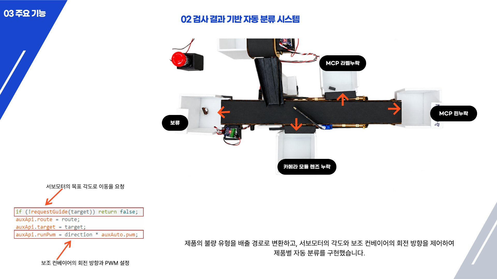
</div>

메인 컨베이어 끝의 슈트로 넘어온 불량품을 **가이드 서보 각도 + 컨베이어 회전 방향** 조합으로 4개의 수거함에 보냅니다.

| 불량 유형 | 경로 | 가이드 서보 | 컨베이어 |
|---|---|:---:|:---:|
| MCP3008 라벨 누락 | LEFT 수거함 | 60° | 역회전 −192 |
| 카메라 모듈 렌즈 누락 | RIGHT 수거함 | 157° | 역회전 −192 |
| MCP3008 핀 누락 | 끝단(END) | 5° (통과) | 역회전 −192 |
| 판정 보류(HOLD) | 반대쪽 끝단 | 5° (통과) | 정회전 +192 |

<div align="center">
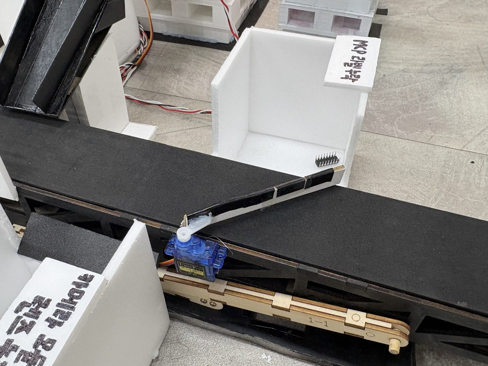 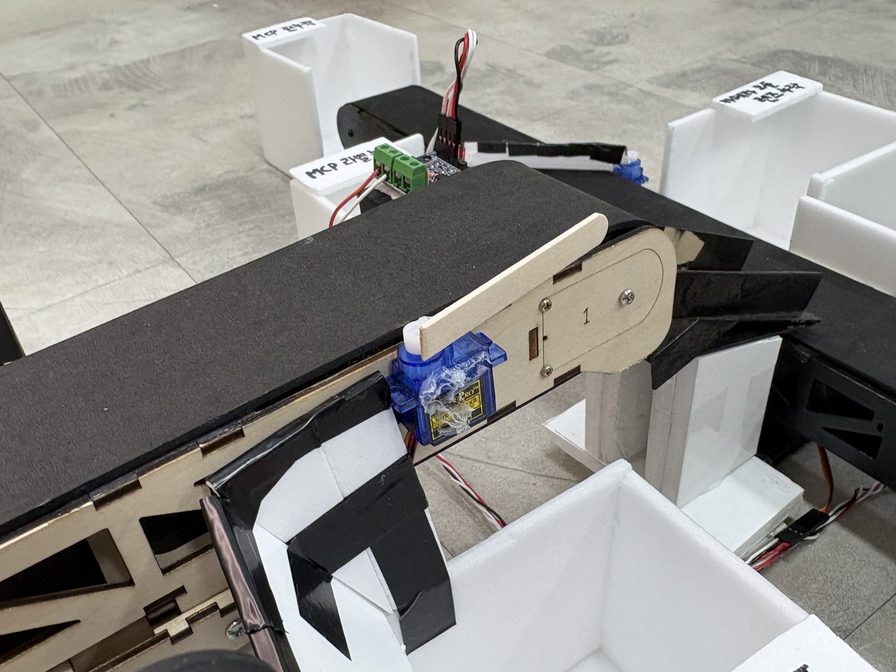
<br><sub>불량분류 컨베이어의 분류 가이드 서보(SG90)와 끝단</sub>
</div>

### 동작 순서 — 메인과 맞물리는 상태 머신

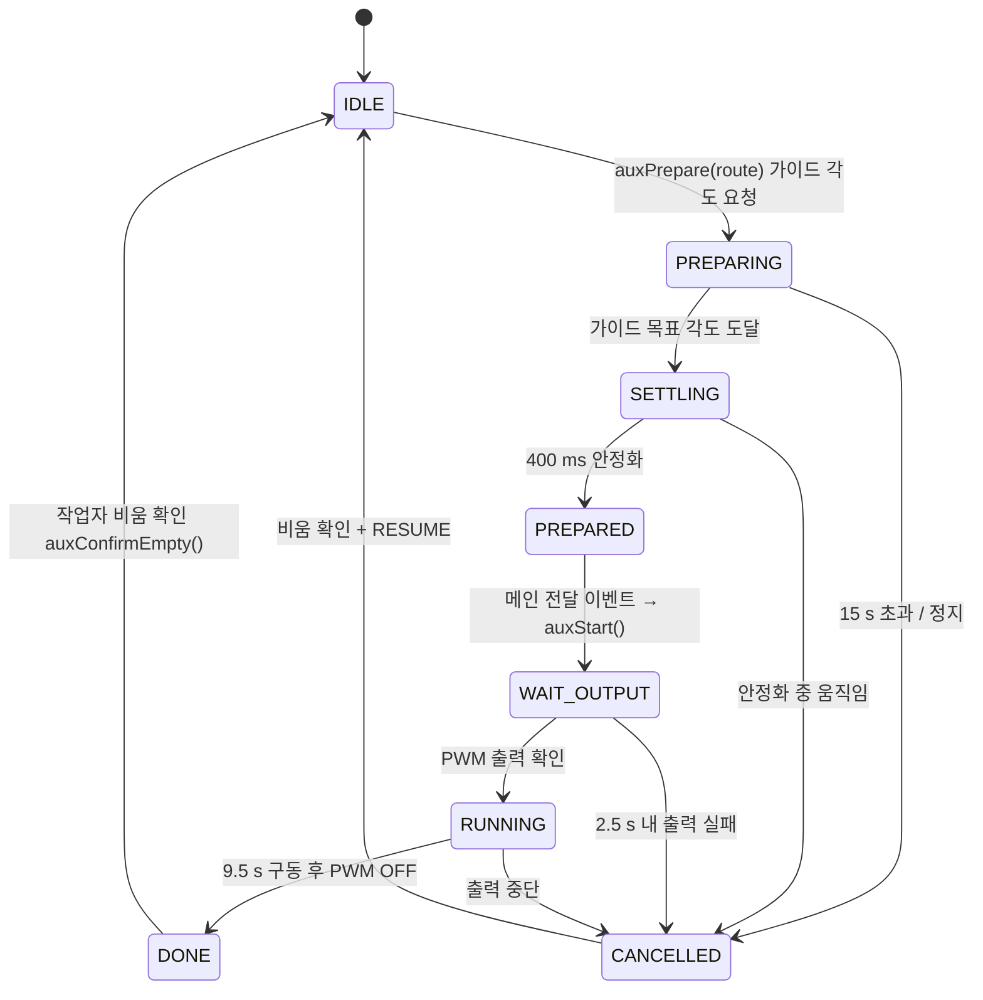

> **핵심 원칙** — 메인 컨베이어가 제품을 넘기기 **전에** 가이드를 미리 돌려 놓고(준비), 넘긴 **뒤에만** 벨트를 돌립니다.
> 벨트가 도는 중에는 가이드를 움직일 수 없고, 센서가 없으므로 "구동 끝"을 "배출 완료"로 착각하지 않도록 **작업자 비움 확인 전에는 다음 제품을 받지 않습니다.**

### 🔧 핵심 구현

<details open>
<summary><b>1. 불량 경로 → 서보 각도 · 회전 방향 변환</b></summary>
<br>

```cpp
bool auxPrepare(AuxRoute route) {
  if (auxApi.phase != API_IDLE || stopLatched || !beltIdle() || guide.moving ...)
    return false;                                   // 바쁨 · 정지 · 설정 오류면 거부
  switch (route) {
    case AUX_LEFT:  slot = LEFT_SLOT;   direction = auxAuto.defectDirection; break;
    case AUX_RIGHT: slot = RIGHT_SLOT;  direction = auxAuto.defectDirection; break;
    case AUX_END:   slot = CENTER_SLOT; direction = auxAuto.defectDirection; break;
    case AUX_HOLD:  slot = CENTER_SLOT; direction = auxAuto.holdDirection;   break;
  }
  if (!requestGuide(positions[slot])) return false; // 서보를 목표 각도로 이동 요청
  auxApi.runPwm = direction * auxAuto.pwm;          // 회전 방향 × PWM 192
  auxApi.phase  = API_PREPARING;
  auxAuto.needsEmptyConfirmation = true;            // 끝나면 반드시 비움 확인
  return true;
}
```
<sub>원본: <code>firmware/aux_conveyor/aux_sensorless_main_bridge_D11.ino</code> (일부 조건 축약)</sub>
</details>

<details>
<summary><b>2. 모터 드라이버 보호 — 양쪽 끄고 한쪽만 켜기 · 역회전 1초 간격</b></summary>
<br>

H-브리지 두 입력에 동시에 PWM이 걸리지 않도록 **항상 둘 다 0으로 만든 뒤** 한쪽만 출력합니다.
방향을 바꿀 때는 바로 반대로 돌리지 않고 **1초 정지 후** 예약된 방향으로 재출발합니다.

```cpp
void writeBelt() {
  analogWrite(AUX_IA, 0); analogWrite(AUX_IB, 0);   // 먼저 양쪽 OFF
  if (value > 0)      analogWrite(AUX_IA,  value);  // 정회전
  else if (value < 0) analogWrite(AUX_IB, -value);  // 역회전
}
// 반대 방향 요청 → stopBelt() 후 pending에 저장 → 1000 ms 뒤 serviceBelt()에서 시작
```
</details>

<details>
<summary><b>3. 서보 속도 제한 — 초당 60°로 천천히</b></summary>
<br>

SG90에 목표 각도를 한 번에 주면 가이드가 튀면서 제품을 칠 수 있어,
**20 ms마다 `속도 × 경과 시간`만큼만** 각도를 옮겨 부드럽게 이동시킵니다.

```cpp
const int32_t step = speedDps * elapsed;            // 60 °/s × ms → milli-degree
const int32_t distance = guide.target - guide.output;
if (abs(distance) <= step) { guide.output = guide.target; guide.moving = false; }
else guide.output += distance > 0 ? step : -step;
writeGuide();                                        // writeMicroseconds로 출력
```
</details>

<details>
<summary><b>4. 논블로킹 + 시간 상한</b></summary>
<br>

- `delay()` 없이 `auxUpdate()`가 매 `loop()`마다 상태만 확인 → 메인 컨베이어 · 시리얼 · 환경 측정과 한 Mega에서 함께 동작
- 벨트 출력은 **최대 10초**에서 자동 OFF, 가이드 준비 15초 · 출력 시작 2.5초 초과 시 자동 취소
- 로그는 링 버퍼에 쌓아 두고 루프마다 일부만 전송 → 시리얼 출력 때문에 제어 주기가 밀리지 않음
</details>

<details>
<summary><b>5. 메인 연동 API — 함수 9개로 분리</b></summary>
<br>

처음에는 단독 시험용 스케치였지만, 최종 목표가 **Mega 한 대에 메인 + 보조 하나의 펌웨어**였기 때문에
메인이 호출할 수 있는 인터페이스로 분리했습니다. ([`AuxConveyor.h`](firmware/aux_conveyor/AuxConveyor.h))

```cpp
bool auxPrepare(AuxRoute route);   // 가이드 이동 요청, 벨트 OFF
bool auxIsPrepared();              // 가이드 도착 + 400 ms 안정화 완료
bool auxStart();                   // 메인 전달 이벤트 시 PWM 시작
void auxUpdate();                  // 매 loop() 호출 (논블로킹)
bool auxIsDone();                  // 구동 완료 — 실제 배출 확인 아님
bool auxIsReady();                 // 다음 회차 받을 준비 완료
void auxCancel();                  // 정지 + 잠금 + 비움 확인 요구
bool auxConfirmEmpty();            // 작업자 육안 확인 후에만 호출
```
</details>

<br>

## 🙋‍♀️ 내 역할 ② — 긴급정지 (NC 접점)

| 항목 | 내용 |
|---|---|
| 배선 | 비상정지 버튼 **NC 접점 D26 ↔ GND**, 내부 풀업 |
| 판정 | 평상시 접점 닫힘 = LOW / **누름 · 단선 = HIGH → 정지** |
| 동작 | 메인 · 보조 PWM, 예약 동작, 서보 이동 즉시 취소 후 **정지 잠금** |
| 복구 | 버튼을 풀어도 자동 재시작하지 않음 → `VERIFYEMPTY` → `RESUME` 성공 → `CLEAR` 순서만 허용 |

**왜 NC(평상시 닫힘)인가** — NO 접점은 선이 빠지면 버튼을 눌러도 신호가 안 들어옵니다.
NC는 **선이 끊어지는 것 자체가 정지 신호**가 되므로 배선 고장도 안전한 쪽으로 처리됩니다.

```cpp
void pollEstop() {
  const bool open = digitalRead(ESTOP_INPUT_PIN) != LOW;   // NC 열림 = 누름 또는 단선
  const bool newlyOpened = open && !estopWasOpen;
  estopWasOpen = open;
  if (!open || (estopLatched && !newlyOpened)) return;
  estopLatched = true;
  haltAll(false, "ESTOP_INPUT_OPEN");                      // 모든 출력 OFF + 잠금
}
bool estopCommandAllowed(const char *cmd, uint8_t count) {
  if (!estopLatched) return true;
  // 잠금 중에는 상태 조회 · 정지 · 비움 확인 · 복구 명령만 허용
  return count == 1 && (!strcmp(cmd, "STATUS") || !strcmp(cmd, "STOP") ||
         !strcmp(cmd, "VERIFYEMPTY") || !strcmp(cmd, "RESUME") || ...);
}
```

> ⚠️ 구동 전원을 직접 끊는 안전 릴레이가 아닌 **소프트웨어 정지 입력**입니다.

<br>

## 🙋‍♀️ 내 역할 ③ — 환경 모니터링 (DHT11 + 부저 + MFC)

<div align="center">
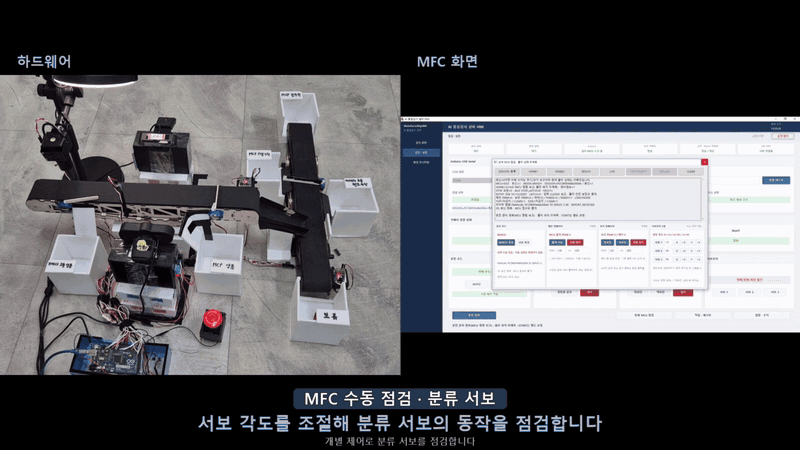
<br><sub>MFC 환경 모니터링 탭 — 실시간 온습도, 추이 그래프, 정상 · 주의 · 위험 상태</sub>
</div>

<br>

| 항목 | 내용 |
|---|---|
| 센서 | DHT11 → **D18 외부 인터럽트**로 응답 펄스 수집 (2초 주기) |
| 경보 | 수동 피에조 부저 D8 — 주의 2 kHz 1회 / 위험 2.5 kHz 2회 (2초 간격) |
| 기본 기준 | 주의 **28 °C / 65 %** · 위험 **35 °C / 80 %** |
| MFC | 실시간 값 · 온도/습도 추이 그래프 · 상태 배지 · 이벤트 기록 · **측정/이벤트 CSV 내보내기** |
| 기준 변경 | MFC에서 `환경 기준 저장` 1회 → Mega가 같은 값으로 **ACK한 경우에만 적용 완료** 표시 |

**설계 포인트**
- DHT11은 수십 µs 단위 펄스를 읽어야 해서 보통 `delay`로 기다리는 방식을 쓰는데, 그러면 같은 Mega의 컨베이어 제어가 멈춥니다.
  → 통합 펌웨어에서는 **외부 인터럽트로 엣지 시각만 기록**하고 해석은 루프에서 단계별로 진행해 제어 주기를 막지 않습니다.
- 환경 이상은 **제품 불량이나 공정 FAULT와 분리**해서 기록합니다. 습도가 높다고 검사 결과가 바뀌지 않도록.
- 측정이 7초 이상 갱신되지 않으면 값 대신 **센서 오류** 상태로 표시합니다.

<br>

## 🎛 MFC 수동 점검 — 보조 컨베이어 · 분류 서보

<div align="center">
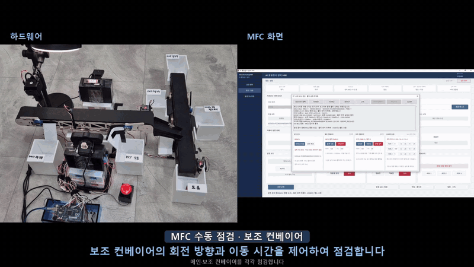
<br><sub>MFC에서 보조 컨베이어 회전 방향 · 구동 시간과 분류 서보 각도를 개별 점검</sub>
</div>

<br>

## 🔌 핀 구성 (내 담당)

| 장치 | Mega 핀 |
|---|:---:|
| 불량분류 컨베이어 모터 드라이버 IA / IB | D5 / D6 (PWM) |
| 분류 가이드 서보 SG90 | D11 |
| 긴급정지 버튼 NC 접점 | D26 ↔ GND |
| DHT11 DATA | D18 (INT) |
| 피에조 부저 | D8 |

<div align="center">
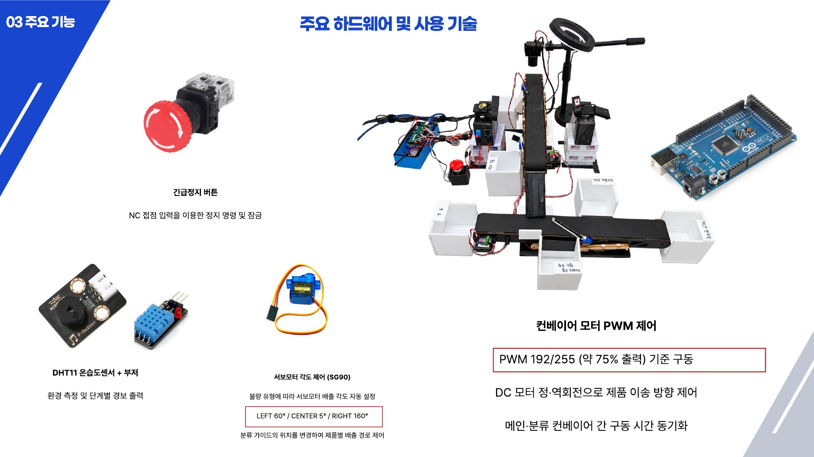
</div>

<br>

## 🧯 트러블슈팅

| 문제 | 원인 · 확인 | 해결 |
|---|---|---|
| 우측 경로 가이드 각도 보정 | 설계값 160°는 실제 장착 상태와 차이 | 실물을 보며 각도를 다시 맞춰 **157°로 조정** |
| 보조 컨베이어 구동 시간 보정 | 처음 정한 8초는 실측 전 기준값 | 실제 배출에 맞춰 **8.0 → 9.5초**로 조정 |
| 렌즈 누락 제품이 RIGHT로 분류되지 않음 | 분류 서보가 명령에도 움직이지 않음 → 다른 서보로 바꿔 대조 | **서보 자체 고장** 확인, 하드웨어 교체로 분리 |
| 긴급정지 버튼 접점 문제 | NC 접점 입력이 의도대로 들어오지 않음 | 접점 문제 해결 후 `NC_OPEN=1/0` · 메인 구동 중 정지 · 잠금 · 복구 확인 |
| 단독 스케치를 메인과 합칠 수 없음 | 두 스케치 모두 `setup/loop` · 시리얼 파서를 따로 가짐 | 보조를 **함수형 모듈(API 9개)** 로 분리, 메인이 유일한 FSM · 명령 수신을 소유 |

<br>

## 📁 폴더 구조

```
ai-vision-sorting-line/
├── firmware/
│   ├── aux_conveyor/
│   │   ├── aux_sensorless_main_bridge_D11.ino   # 불량분류 컨베이어 · 가이드 서보 코어
│   │   └── AuxConveyor.h                        # 메인 연동 API
│   └── integration/
│       ├── EstopInput.inc                       # D26 NC 긴급정지 (통합 펌웨어 반영본)
│       └── EnvironmentMonitor.inc               # DHT11 · 부저 (통합 펌웨어 반영본)
├── mfc/EnvironmentMonitoring/                   # MFC 환경 탭 · 그래프 · CSV
└── docs/images/
```

> `firmware/integration/`의 두 파일은 제가 만든 모듈을 팀장이 통합 펌웨어(Mega 단일 프로그램)에 연결한 최종본입니다.
> 전체 빌드 · 실행은 [팀 저장소](https://github.com/smlee11-hash/Moble-2nd-Team-Project)를 기준으로 합니다.

<br>

## 💭 느낀 점

Arduino와 MFC를 함께 다루면서 **하드웨어와 소프트웨어가 맞물리는 지점**을 직접 설계해 볼 수 있었습니다.
특히 센서 없이 시간으로만 움직이는 컨베이어에서 "명령이 끝났다"와 "제품이 실제로 나갔다"를 구분하고,
정지 · 복구 순서를 명확히 정하는 것이 **장비를 안전하게 반복 운전하는 핵심**이라는 것을 배웠습니다.
반복 시험과 오류 해결을 거치며 문제 해결 능력과 시스템 안정성의 중요성을 체감했습니다.


